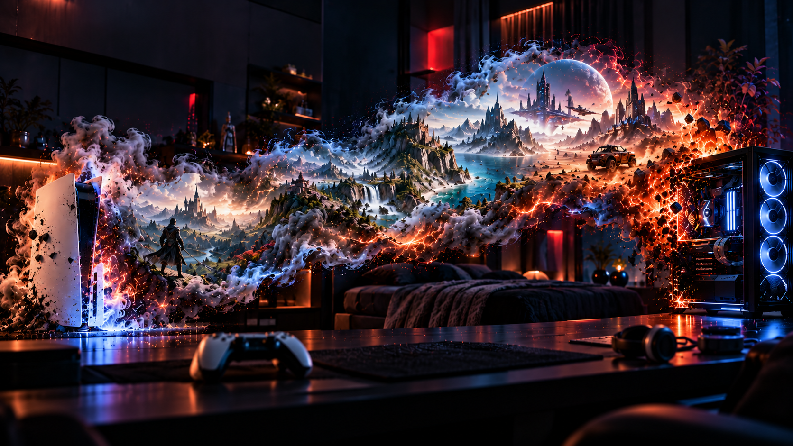

# PC5

<p align="center"></p>
<p align="center"></p>

<p align="center">
  <a href="https://github.com/bornaradusin/PC5/releases/latest"><b>Download</b></a> ·
  <a href="https://github.com/bornaradusin/PC5/wiki"><b>Wiki</b></a> ·
  <a href="https://github.com/bornaradusin/PC5/wiki/Game-compatibility"><b>Game compatibility</b></a> ·
  <a href="https://github.com/bornaradusin/PC5/issues"><b>Report a problem</b></a>
</p>

PC5 is a launcher for your own PC games on a PS5 that runs homebrew. It installs games from a
USB drive, shows them as a row of covers, and runs them with
[prospero-win](https://github.com/mpereiraesaa/prospero-win) (Wine on the PS5). The app is
`PPSA11018`, and its tile is called **PC5**.

No game is part of PC5, and PC5 downloads none: you install the games you own.

<p align="right">
  <a href="https://www.buymeacoffee.com/bornaradusin">
    
  </a>
</p>

## Getting started

1. Install PC5 from **ProsperoStore**, or download `PPSA11018.zip` from
   [the releases](https://github.com/bornaradusin/PC5/releases/latest), unzip it and copy the
   `PPSA11018` folder to the console the way you add any homebrew app.
2. Put each game's installed folder (the one with its `.exe`) at the top of an **exFAT** USB
   drive, or in a `Games` folder there.
3. In PC5 press **Options** › **Game maintenance** › **Install games from USB**, choose the game,
   then press **✕** to play. Hold the **touchpad** and **Options** for two seconds to leave a game.

Each game has its own menu (**△**) for its controller, graphics, cover, home screen tile,
program, updating and uninstalling. PC5 updates itself from **Settings** › **System**.

## The wiki

Everything else is in the **[wiki](https://github.com/bornaradusin/PC5/wiki)**:

| Page | What it covers |
| --- | --- |
| [Installing and updating PC5](https://github.com/bornaradusin/PC5/wiki/Installing-and-updating) | Putting PC5 on the console, and updating it |
| [Installing games](https://github.com/bornaradusin/PC5/wiki/Installing-games) | USB drives, several games in a row, the right program, uninstalling |
| [Playing games](https://github.com/bornaradusin/PC5/wiki/Playing-games) | The game's menu: frame generation, resolution, aspect ratio, memory, .NET |
| [Controllers](https://github.com/bornaradusin/PC5/wiki/Controllers) | Xbox controller, DualSense, keyboard and mouse, button mapping, more players |
| [Settings](https://github.com/bornaradusin/PC5/wiki/Settings) | The overlay, vibration, light bar, adaptive triggers, updates |
| [Covers](https://github.com/bornaradusin/PC5/wiki/Covers) | Where covers and backgrounds come from, and your own |
| [Home screen tiles](https://github.com/bornaradusin/PC5/wiki/Home-screen-tiles) | A game on the PS5's home screen |
| [Launch options](https://github.com/bornaradusin/PC5/wiki/Launch-options) | A game's command line (`launch.txt`) |
| [File manager](https://github.com/bornaradusin/PC5/wiki/File-manager) | A game's own files, and the console's, from PC5 |
| [Files and folders](https://github.com/bornaradusin/PC5/wiki/Files-and-folders) | What PC5 keeps where on the console |
| [Troubleshooting](https://github.com/bornaradusin/PC5/wiki/Troubleshooting) and [FAQ](https://github.com/bornaradusin/PC5/wiki/FAQ) | When something doesn't work |
| [Reporting a problem](https://github.com/bornaradusin/PC5/wiki/Reporting-a-problem) | How to report one, and which log to attach |
| [Game compatibility](https://github.com/bornaradusin/PC5/wiki/Game-compatibility) | Games players have tried; [add one](https://github.com/bornaradusin/PC5/discussions/new?category=game-compatibility) |

## What runs

Direct3D 8 to 11 run through DXVK, Direct3D 12 through VKD3D-Proton, Vulkan on RADV, OpenGL
on Mesa Zink, DirectDraw through Wine's Direct3D, and .NET Framework games with Wine Mono.
Games that need a store's launcher or client running (Steam, EA app, Ubisoft Connect, Rockstar
Games Launcher), online DRM, anti-cheat or kernel drivers don't run. Whether a game runs is only
known by trying it: PC5 makes no promise about any game.

## Reporting a problem

Report problems as [GitHub issues](https://github.com/bornaradusin/PC5/issues), not in
ProsperoStore's comments, with the game's log attached (from `/data/prospero-win/logs/`). When
a game crashes, PC5 says so the next time it opens, and **△** there shows a QR code for
GitHub's issue form, already filled in. See
[Reporting a problem](https://github.com/bornaradusin/PC5/wiki/Reporting-a-problem).

## Building

On Debian 13 or Ubuntu 24.04 (x86-64), as root:

```sh
apt-get install -y $(cat tools/packages.txt)
tools/build.sh
```

The app comes out as `release/PPSA11018/` and `release/PPSA11018.zip`, with the source of
everything in it as `release/PPSA11018-sources.tar.xz`. A first build takes a few hours, most
of it Wine. GitHub's build (**Actions** › **Build** › **Run workflow**) runs the same steps and
makes a draft release.

<details>
<summary>More on the build, tests and releases</summary>

- The build is in pieces (the script's first lines name them). Each fetches what it is built
  from, writes `.build/logs/<piece>.log`, and is skipped when its key
  (`tools/build.sh key <piece>`) hasn't changed. `tools/build.sh <piece>` runs one on its own.
  Elsewhere the script runs itself in Docker (`tools/Dockerfile`).
- `tests/test.sh` runs the host checks (after `tools/build.sh sources`), `tests/test.sh --shots`
  also draws every screen, and `tests/PS5-CHECKLIST.md` is what to try on a console.
- Releasing: raise `PC5_VERSION` in `title/pc5.h` and `contentVersion` in
  `sce_sys/param.json`, then publish the build's draft. PC5's updater installs the release's
  `PPSA11018-update.zip` (only the files that changed) or `PPSA11018.zip`, checked against the
  size and SHA-256 GitHub lists, so those names must stay.

</details>

## How it is made

- `title/`: PC5's own code, plain C built into prospero-win's title.
- `patches/prospero-win/`: PC5's patches to prospero-win v0.2.0 and its Wine.
- `patches/dxvk/` and `patches/radv/`: PC5's patches to DXVK and RADV.
- `tools/`: the build, the Windows template, the font atlas and the app.
- `wiki/`: the wiki's pages, copied to the wiki when they change.

## Credits and licence

PC5's own code is free software under the GNU LGPL 2.1 or later ([LICENSE](LICENSE)), like
prospero-win. The app as built holds the PS5 boilerplate's startup code and libc.prx (GPL 3.0
or later), so the app as a whole is under the GPL 3.0 or later; its source is
`PPSA11018-sources.tar.xz`, with Wine Mono's in `wine-mono-11.3.0-src.tar.xz`.

It is built on [prospero-win](https://github.com/mpereiraesaa/prospero-win) by mpereiraesaa and
the projects it uses: Wine, DXVK, Mesa (RADV, Zink; including mihawk-99's PS5 work), the PS5
payload SDK and boilerplate, and the Lapy helper. Also:

- Wine patches from PS5_MihawkOS by mihawk-99 (LGPL 2.1 or later)
- a logging patch from NFS Black Box by lavavex (LGPL 2.1 or later)
- movie and controller fixes by SuperLeiyan (LGPL 2.1 or later, the DXVK one zlib)
- FAudio's resampler fix as Leo Lobato backported it to prospero-win (zlib)
- Wine Mono (MIT, its parts under their own licences), FFmpeg (LGPL 2.1 or later)
- ps5-framegen by Swordpdf (GPL 3.0 or later, its shaders from AMD's FSR3 under MIT)
- VKD3D-Proton (LGPL 2.1 or later), Mbed TLS (Apache 2.0 or GPL 2.0 or later), Mozilla's root
  certificates (MPL 2.0)
- stb_image and stb_image_write (public domain / MIT), Project Nayuki's QR Code generator (MIT)
- the PS5 Forwarder Format by heydemoura (GPL 3.0 or later)
- the Liberation fonts (SIL OFL 1.1), Droid Sans Fallback (Apache 2.0) and Inter (SIL OFL 1.1)

Blur5 and sahin were inspiration only; no code was taken from them. Licence texts are in the
app's `LICENSES/` folder and in `fonts/`; see [NOTICE.md](NOTICE.md).

PC5 is not made by or connected to Sony, Valve, GOG, GitHub, PCGamingWiki or the Wikimedia
Foundation.
