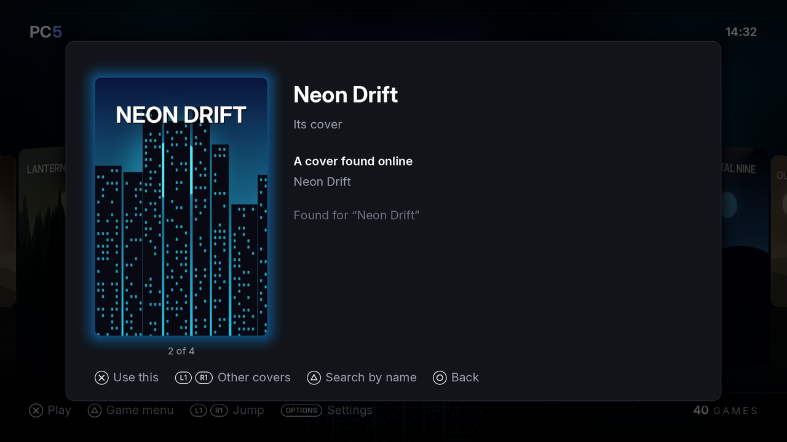
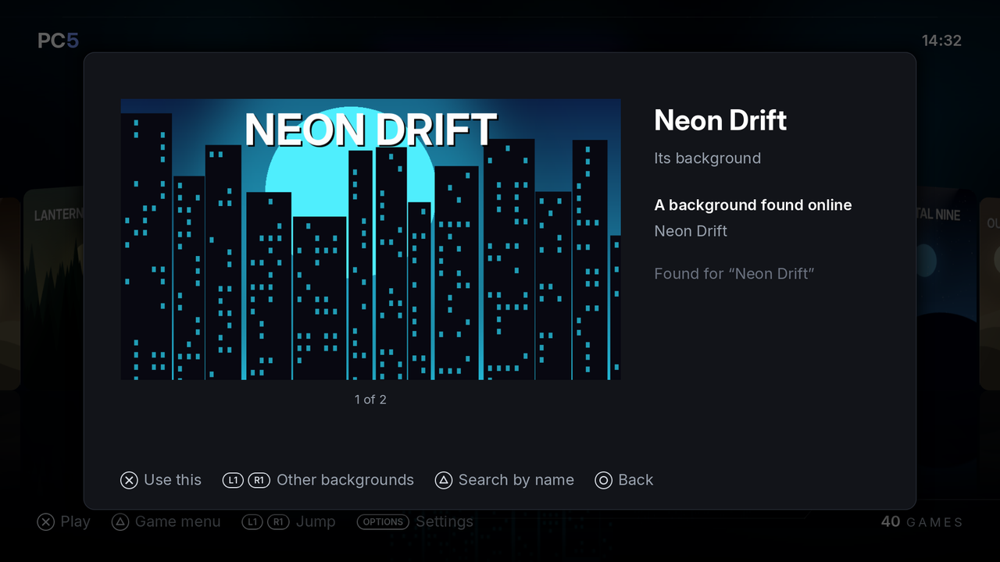
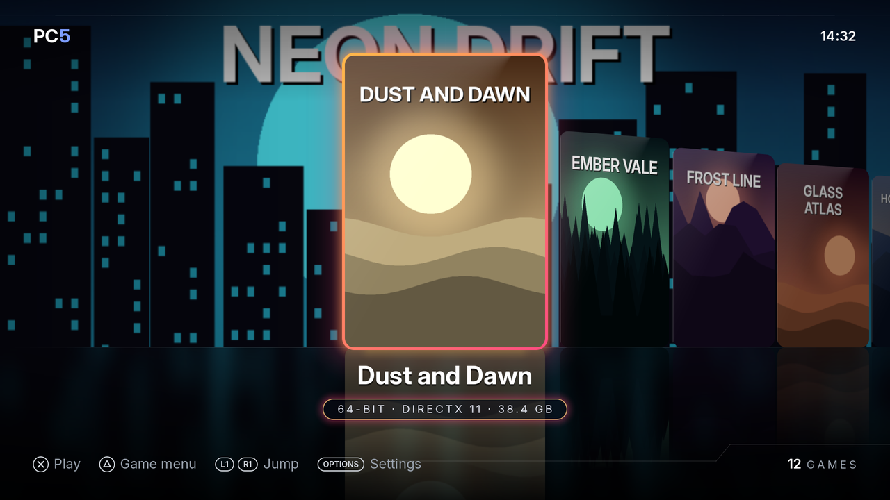

Every game in PC5 has a cover. PC5 looks for it online on public sources, with no account and no key (and on SteamGridDB too if you give PC5 your key), or uses a picture you give it. A game no source has gets a cover made from its own icon and name. A game can have a background too, shown behind the library while it is chosen. This page explains where covers and backgrounds come from, how to choose them, and how to use your own.

## Where covers come from

PC5 looks in this order:

1. **Your own picture**, if you gave one (see [Using your own cover](#using-your-own-cover)).
2. **Steam's store.** If the game's folder has a `steam_appid.txt` at its top, PC5 uses that number to find the game's Steam cover directly.
3. **SteamGridDB**, only if you added your key (see [SteamGridDB](#steamgriddb)): covers its members made, also offered when Steam has a cover, to choose by hand.
4. **GOG's catalogue.**
5. **PCGamingWiki**: the cover on the game's page.
6. **Wikidata**: the Steam game Wikidata names for the game, for a game Steam's own search doesn't find by that name.
7. If none of them has the game: a **card made from the game's icon and name**.

Until PC5 1.9.2, PC5 also took the lead picture of the game's Wikipedia article. It doesn't any more: those were often not the game's cover.

To search, PC5 uses the program's product name, the folder's name (without release tags and version numbers) and the program's name. It only offers results whose name is close to the game's. Each source can be turned off in **Settings › System › Picture sources** (see [Picture sources](Settings#picture-sources)); PC5 doesn't say which source a picture came from.

A source that doesn't answer is skipped. A game installed without internet gets your own picture or its card, and keeps it: to give it another cover later, use [Appearance › Cover](#changing-a-cover-or-background) or [your own picture](#for-a-game-already-installed).

## SteamGridDB

[SteamGridDB](https://www.steamgriddb.com) has covers and backgrounds made by its members, for many games. It needs a key of your own (free). PC5 works the same without one.

1. Make an account on steamgriddb.com and sign in.
2. Open its **Preferences**, then **API**, and make a key. It is a line of letters and numbers.
3. On the console, open `/data/prospero-win/api_keys.txt` with the tool you use to copy files to and from the console. PC5 makes this file the first time it opens. It looks like this:

   ```ini
   # PC5 API keys
   # Enter your API keys below, after the = sign, and save the file.
   ...
   STEAMGRIDDB_API_KEY=
   ```

4. Put your key after `STEAMGRIDDB_API_KEY=` and save the file. For example: `STEAMGRIDDB_API_KEY=0123456789abcdef0123456789abcdef`.
5. Open PC5 again. A key added while PC5 is open also counts the next time you choose a cover or background by hand.

Lines starting with `#` are ignored, as are spaces around the key. PC5 never shows your key or writes it to its logs, and it sends it only to SteamGridDB. Uninstalling a game doesn't touch this file.

**Settings › System › Picture sources** says **No key** for SteamGridDB while there is no key. If SteamGridDB refuses the key (a typo, or a key you deleted there), its row says so: check the key in the file. Either way PC5 carries on with the other sources.

PC5 takes SteamGridDB's still pictures only (no animated ones): covers of 600 × 900 or 660 × 930, and backgrounds of 1920 × 620 (or 3840 × 1240). It asks for the game by its Steam number when Steam (or a `steam_appid.txt`) gave one, and by name otherwise.

## Choosing a cover when installing

The review screen shows the best cover PC5 found, and how many there are: for example "Cover 1 of 3".


*The review screen. L1 / R1 go through the covers found; the last one is the card made from the game's icon.*

1. Press **L1** or **R1** to go through the covers found.
2. The last choice is always the card made from the game's icon and name.
3. Press **✕** to install with the cover shown.

When you install several games in a row, open a game's review screen from the list (**✕**) to change its cover.

## Changing a cover or background

For a game PC5 installed, its menu has both: **△ › Appearance › Cover** or **Background**.


*A cover found for a name typed. L1 / R1 go through the others.*

1. In the library, choose the game, press **△**, choose **Appearance**, then **Cover** or **Background**.
2. PC5 looks online for the game's names, as when it was installed. The first picture shown is the one the game has now.
3. Press **L1** or **R1** (or left and right) to go through what PC5 found. The last one is the card made from the game's icon and name for a cover, or **None** for a background: a backdrop made from the game's cover (see [Backgrounds](#backgrounds)).
4. To look for another name, press **△**: the PS5's keyboard opens with the game's name in it. Type the name to look for and choose **Done**. PC5 shows what it found for that name, the best match first.
5. Press **✕** to use the picture shown. **○** goes back without changing anything.


*A background found for a name typed.*

A cover or background chosen here stays until you choose another. Your own picture (below) still takes its place when you put a newer one in the `covers` or `backgrounds` folder. A home screen tile keeps the picture it was made with: turn the tile off and on again to give it the new cover.

## Using your own cover

Your picture can be a `.jpg`, `.jpeg` or `.png` file. PC5 cuts it to the cover's 2:3 portrait shape, so a 2:3 picture (for example 600 × 900 pixels) fits without being cut. Covers are kept at 480 × 720.

### When installing

Put `cover.jpg`, `cover.jpeg` or `cover.png` at the top of the game's folder on the USB drive. It is the first cover offered on the review screen, as "your picture".

### For a game already installed

1. On the console, make a folder `/data/prospero-win/covers/` if there isn't one.
2. Put your picture in it, named after one of these (upper or lower case doesn't matter):
   - the game's folder name, as it was on the USB drive;
   - the game's name in PC5;
   - the game's id (the name of its folder in `/data/prospero-win/prefixes/`).

   For example: `/data/prospero-win/covers/Neon Drift.png`.
3. Open PC5 (or close it and open it again). The picture becomes the game's cover.

PC5 uses your picture in place of anything online. If you replace the file later, PC5 uses the new picture the next time it opens. PC5 goes by the file's date: the picture is used when it is newer than the game's current cover. If a picture you copied keeps an old date, save it again so it gets today's date.

## Games without a cover yet

A game installed some other way (not with PC5) has no cover at first. When PC5 opens, it looks for covers for such games before it shows the library. The screen says "Getting covers" with a count. Press **○** to skip: PC5 tries again the next time it opens.

Until a cover is found, the library shows the game's card. Offline, PC5 looks again each time it opens, and only keeps the card once a source has answered without a match.

## Where a cover is used

- In the library, and in the Uninstall game list and dialog.
- As the picture of the game's [home screen tile](Home-screen-tiles). The tile's picture is made when the tile is made: after changing a cover, turn the tile off and on again.
- For the light bar, when **Settings › In games › Light bar** is **Game's colour**: the light bar shows the cover's main colour.

The cover is kept with the game in `/data/prospero-win/prefixes/<game>/pc5/cover.bin`, as PC5 shows it (480 × 720). The picture as downloaded isn't kept: PC5 1.9.3 deletes the copies (`cover-original.jpg` or `.png`) earlier versions kept. Choosing another cover replaces it.

Uninstalling the game deletes its cover and background, also when you keep its saves: kept saves don't keep pictures, and installing the game again gets them anew. Your own pictures in `covers` or `backgrounds` (below) stay.

## Backgrounds

While a game is chosen in the library, its background fills the screen behind the covers, a little darker at the top and the sides so the clock and covers stay easy to read, and mirrored in the floor the covers stand on. A game without one gets a backdrop made from its cover: the cover, blurred to its colours.


*A game with a background of its own.*

PC5 finds backgrounds by itself, in the background while the library shows, for every game that has none yet, games installed with an earlier PC5 included. It looks in this order:

1. **Your own picture**, if you gave one (see below).
2. The background of the **cover chosen when the game was installed**: Steam's library background for a Steam cover (also for a PCGamingWiki or Wikidata cover of a Steam game), GOG's background for a GOG cover.
3. A **search**, as for covers, with the sources turned on: Steam's library background, SteamGridDB's (with your key) or GOG's background of the best match. A game can have a cover from one source and a background from another: when Steam has the game's cover but no background, SteamGridDB's background is used.

A game no source has a background for keeps the backdrop made from its cover, and PC5 doesn't look online for it again; your own picture still works for it. To choose another background, or none, see [Changing a cover or background](#changing-a-cover-or-background).

### Using your own background

Your picture can be a `.jpg`, `.jpeg` or `.png` file. PC5 cuts it to the screen's 16:9 shape, so a 16:9 picture (for example 1920 × 1080) fits without being cut. Backgrounds are kept at 960 × 540.

- **When installing:** put `background.jpg`, `background.jpeg` or `background.png` at the top of the game's folder on the USB drive.
- **For a game already installed:** make a folder `/data/prospero-win/backgrounds/` and put the picture in it, named as for [your own cover](#for-a-game-already-installed): the game's folder name, its name in PC5 or its id. For example: `/data/prospero-win/backgrounds/Neon Drift.jpg`.

PC5 picks the picture up the next time it opens, when it is newer than the game's background. The background is kept in `/data/prospero-win/prefixes/<game>/pc5/background.bin`; uninstalling the game deletes it, also when you keep its saves.
