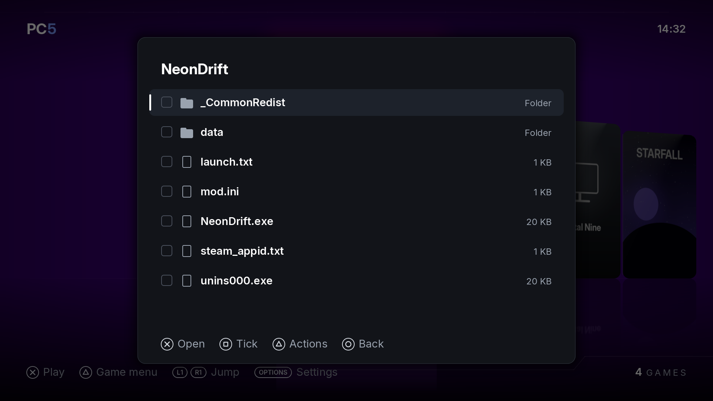

PC5 has a file manager for the console's own files, in two places:

- **A game's own folder**: in the library, press **△** on the game, then **Manage › Game files**. It opens the folder PC5 installed the game in, and nothing above it. Use it to add a mod, delete a file a game doesn't need, or copy a save out. It is there for games PC5 installed.
- **The whole console**: **Settings › File manager** (press **Options** in the library). It starts with the places there are: **Console storage** (`/data`), each **USB drive** and **Extended storage** drive plugged in, **PC5's app**, **PC5's INSTALL folder** and the **Whole console** (`/`).

*Manage › Game files: the game's own folder.*

## Buttons

| Button | What it does |
| --- | --- |
| **✕** | Opens a place or a folder. On a file, shows what can be done with it. |
| **□** | Ticks the item, or unticks it. What you do next is done to all the ticked items. |
| **△** | Shows what can be done: with the ticked items, or with the chosen one when none is ticked. |
| **○** | Goes to the folder above, and back out from the top. |
| **L1** / **R1** | Moves eight rows up or down. |

## What △ offers

| Row | What it does |
| --- | --- |
| Copy | Remembers the items. **Paste** in another folder puts a copy there. |
| Cut | The same, but **Paste** moves them. On the same drive that is at once; to another drive PC5 copies everything first and deletes the originals only when all of it is in place. |
| Paste | Puts what you copied or cut into this folder, with a bar showing how far it is, and **○** to stop. When the folder has some of the names already, PC5 asks: **Skip** leaves those as they are, **Keep both** names the new ones "name (2)", **Replace** overwrites files and puts folders' contents together. |
| Rename | Types a new name with the console's keyboard. |
| New folder | Makes an empty folder here. |
| Delete | Asks first, saying how many files and folders and how much it deletes. There is no undo. |
| Tick all | Ticks every item in the folder, or unticks them all. |

What you copy stays remembered while PC5 is open, so you can copy a mod from a USB drive in **Settings › File manager** and paste it in a game's folder from **Manage › Game files**.

A file is copied under a temporary name (`<name>.pc5part`) and renamed when it is whole. A copy you stop, or a console turned off part way, leaves no half file under the real name. Stopping keeps what was finished, and a move then deletes nothing from where it came from.

## What it won't change

PC5 writes only to Console storage (`/data`), USB drives and Extended storage. **PC5's app** and the **Whole console** are read-only: you can look and copy from them, nothing more. PC5's own folder is read-only wherever it is, except its INSTALL folder: paste a game's folder there and PC5 offers to install it the next time it opens (see [The INSTALL folder](Installing-games#the-install-folder)). PC5 never deletes, moves or renames a drive itself, `/data/prospero-win`, PC5's own folder or its INSTALL folder (it can change what is inside `/data/prospero-win`, so take care there: deleting a game's files from there can stop it running).

Names follow exFAT's rules, so they work on USB drives too: no `\ / : * ? " < > |`, no name ending in a space or a dot, and 255 bytes at most.

The file manager doesn't change permissions, open or edit files, show pictures, or unpack archives.
