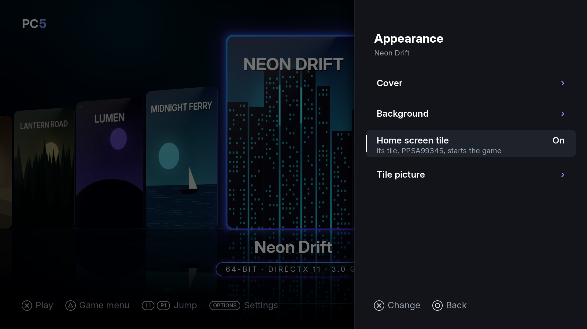

A game installed in PC5 can have its own tile on the PS5's home screen. The tile is a small app of its own, a few MB in size. It starts its game straight away, without PC5's screens, and leaving the game takes you back to the home screen. Tiles were added in PC5 1.3.0. From 2.0.0 each tile is an app of its own, thanks to SuperLeiyan.

*The game's Appearance: Home screen tile is On, with the tile's title ID, and its Tile picture.*

## What you need

PC5 writes the tile in `/data/homebrew`, under a title ID of its own (`PPSA99…`). On the console you need:

- **ShadowMountPlus**, or another homebrew mounter that registers the apps in `/data/homebrew`. The tile appears on the home screen once the mounter has registered it.
- **elfldr**, the payload loader (port 9021). The tile uses it each time it starts, as PC5 does.

The tile loads Wine and PC5's other files from PC5's own folder (`/data/homebrew/PPSA11018`, say), so keep PC5 where it is.

## Adding a tile

1. In the library, choose the game and press **△**.
2. Choose **Appearance**, then **Home screen tile**, and press **✕**.
3. PC5 says "Added to the home screen" and gives the tile's title ID (`PPSA99…`). The row now says **On**.
4. Close PC5. ShadowMountPlus then finds the tile in `/data/homebrew` and it appears on the home screen.

## Using a tile

1. Choose the game's tile on the home screen.
2. The game starts at once, behind a loading screen.
3. To leave, quit the game from the **PS button**'s menu. You go back to the home screen.

Holding the touchpad and **Options** doesn't close a game started from its tile: the tile is closed like any other app. Games started from PC5's library keep the touchpad and Options.

If the game can't start (it was uninstalled, or something is wrong with it), PC5's screens open with the reason.

## The tile's picture

The tile's picture is made from the game's cover, and the background you see when the tile is chosen is the game's background (PC5's own when the game has none).

- **△ › Appearance › Tile picture** chooses a square picture for the tile instead. Square pictures come from SteamGridDB only, so this needs your own SteamGridDB key in `api_keys.txt` (see [Covers](Covers)). **Made from its cover** goes back to the cover.
- When you change the game's cover, background or tile picture, PC5 shows "Updating the home screen tile" for a moment and redoes the tile's art. A tile the console has already registered may need a console restart to show its new art.

## When PC5 updates

The tile's program must match PC5's. Each time PC5 opens, it gives every tile it made this PC5's program when it has changed, so tiles keep working after an update.

## Tiles made before 2.0.0

A tile made by an earlier PC5 starts PC5 with its game through the PS5 Forwarder Format, and needs the forwarder's launcher payload as well. It stays as it was. To make it an app of its own, turn its row off and on again: **△ › Appearance › Home screen tile**.

## Removing a tile

Do one of these:

- Turn the row off: **△ › Appearance › Home screen tile** and **✕**. PC5 says "Taken off the home screen".
- [Uninstall the game](Installing-games#uninstalling-a-game). Its tile's folder is deleted with it.

Either way, PC5 deletes the tile's folder in `/data/homebrew`. If the tile is still on the home screen after that, delete it there.

## If something goes wrong

| What you see | What to do |
| --- | --- |
| The tile doesn't appear on the home screen | Close PC5, then check that ShadowMountPlus (or your mounter) is running, and that the tile's folder (`/data/homebrew/PPSA99…`) is there. |
| The tile does nothing | Check that elfldr is running: the tile needs it each time it starts. |
| The tile stopped working after you moved PC5 | Open PC5 from its new folder once: it gives the tiles that folder. |
| "This tile's game can't start" | The game isn't in PC5 any more, or can't start. Take the tile off the home screen, or install the game again. |
| "The tile wasn't made" | PC5 gives the reason under the title. Check the free space and that `/data/homebrew` can be written. |
