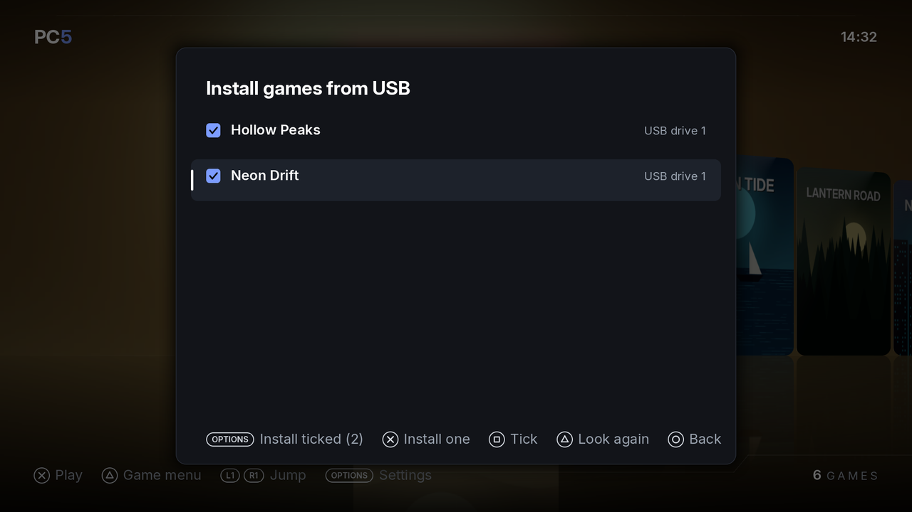
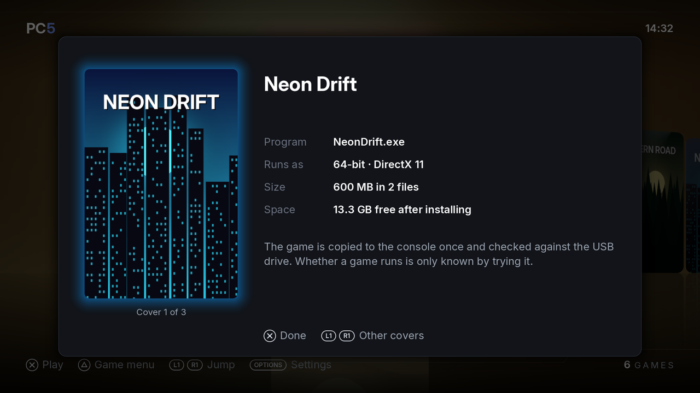
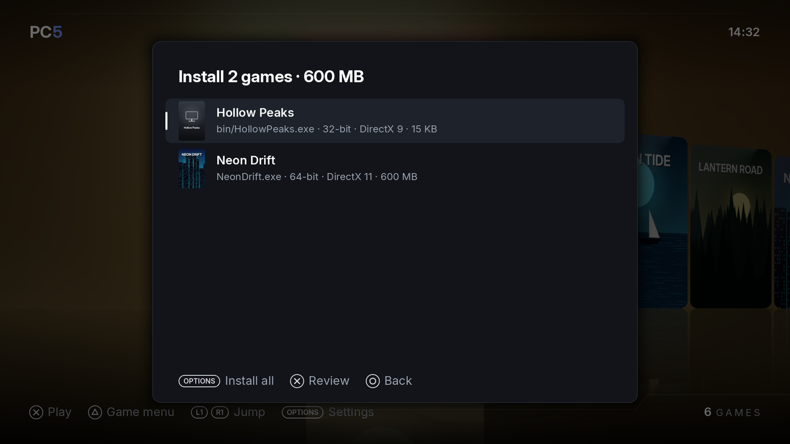
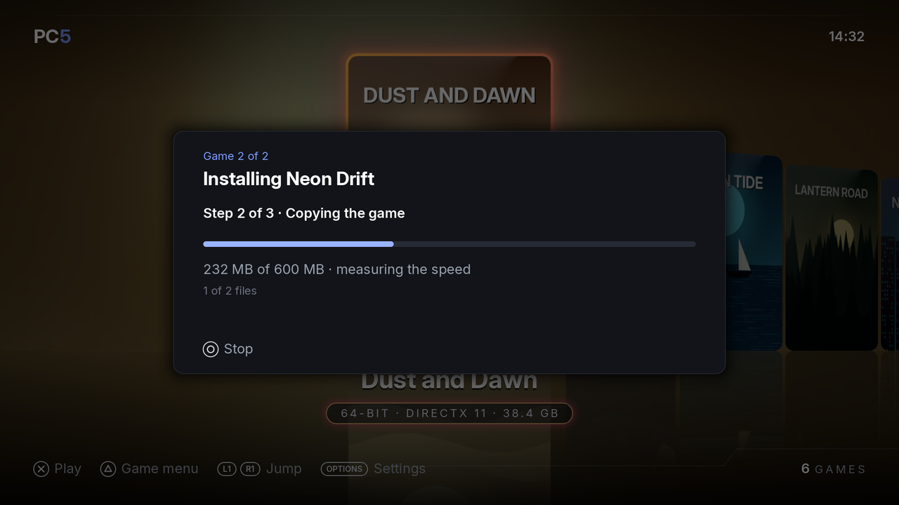
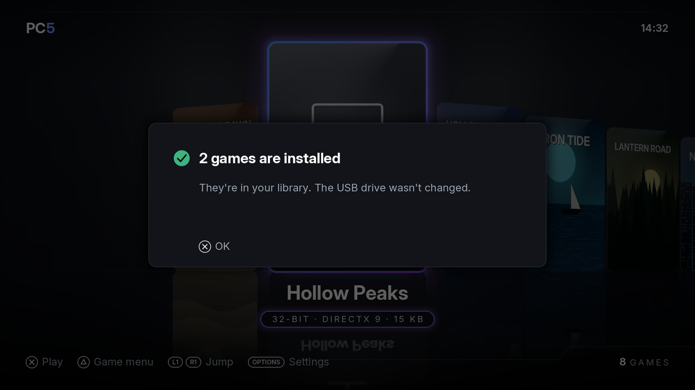
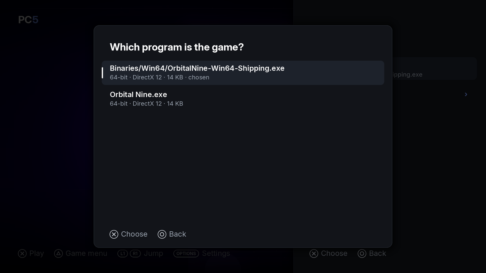
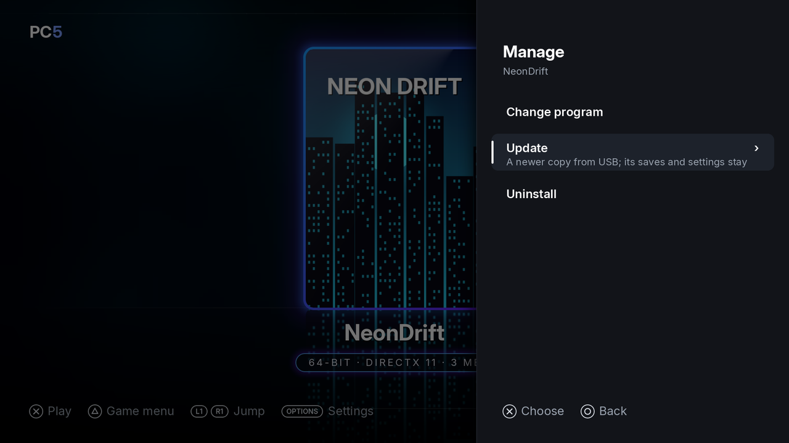
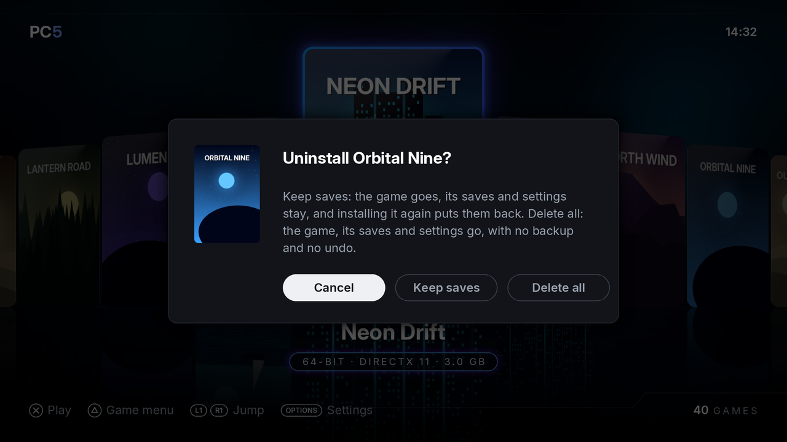

PC5 installs games from a USB drive. You put each game's installed folder on the drive, choose it in PC5, and PC5 copies it to the console once, checks the copy against the drive and adds the game to your library. You can install one game at a time or several in a row, [play a game from its USB drive](#playing-a-game-from-its-usb-drive) without copying it, or [put a game in PC5's INSTALL folder](#the-install-folder) over FTP. This page also covers choosing the right program for a game, updating a game and uninstalling games.

## Preparing the USB drive

1. Format the drive as **exFAT**.
2. Copy each game's installed folder (the folder with the game's `.exe` in it) to the top of the drive, or into a folder called `Games` at the top.
3. Name each folder the way you want the game to be called in PC5. The folder's name becomes the game's name.
4. Plug the drive into the PS5.

For example:

```text
USB drive (exFAT)
├── Neon Drift/
│   ├── NeonDrift.exe
│   ├── cover.png          optional: your own cover (see Covers)
│   └── data/
└── Games/
    └── Hollow Peaks/
        └── bin/
            ├── HollowPeaks.exe
            └── launch.txt  optional: launch options (see Launch options)
```

Good to know:

- Use the game as it is installed on a PC, not its installer. PC5 copies the folder as it is and doesn't run setup programs.
- The game's program can be in a subfolder. PC5 looks up to six folder levels deep.
- File and folder names must be names Windows accepts: none of `< > : " | ? * \`, no name ending in a dot or a space, and no reserved names such as `CON` or `NUL`.
- A `steam_appid.txt` at the top of the folder (many Steam games have one) helps PC5 find the right cover.
- You can put a `cover.jpg`, `cover.jpeg` or `cover.png` at the top of the folder to use your own cover. See [Covers](Covers).
- You can put a `launch.txt` beside the game's `.exe` to give it launch options. It is copied with the game. See [Launch options](Launch-options).
- PC5 never writes to the USB drive (a game that [plays from it](#playing-a-game-from-its-usb-drive) may write its own files there).

## Installing one game

1. In the library, press **Options** to open Settings, and choose **Game maintenance › Install games from USB**.
2. PC5 lists the game folders it found on every USB drive plugged in. Choose one and press **✕**.
3. PC5 reads the folder, finds its program and looks for its cover. The review screen opens.
4. Check the review screen, then press **✕** to install.


*Install games from USB: the game folders PC5 found. Two are ticked for installing in a row.*

| Button | On the folder list |
| --- | --- |
| ✕ | Install the chosen folder (after its review screen) |
| □ | Tick or untick the folder |
| Options | Install the ticked folders (shows how many are ticked) |
| △ | Look at the USB drives again (after plugging in a drive) |
| ○ | Back to Settings |

The review screen shows what PC5 is about to do:


*The review screen: the cover PC5 found, the program it will start, the size and the space left.*

| Row | What it tells you |
| --- | --- |
| Program | The `.exe` PC5 will start, inside the game's folder |
| Runs as | 32-bit or 64-bit, and what the game draws with (DirectX 8 to 12, Vulkan, OpenGL, DirectDraw or plain Windows) |
| Size | The folder's size and how many files it has |
| Space | The free space left after installing, or "not enough" |

| Button | On the review screen |
| --- | --- |
| ✕ | Install (in a list of several games: Done) |
| △ | Play from USB: see [Playing a game from its USB drive](#playing-a-game-from-its-usb-drive) |
| L1 / R1 | Show the other covers PC5 found. See [Covers](Covers). |
| □ | Choose another program, when the folder has more than one |
| ○ | Back to the folder list |

If the program is a .NET program, the review screen says so: it runs with Wine Mono, which PC5 sets up the first time a .NET game starts. See [.NET games](Playing-games#net-games).

## Installing several games in a row

1. In **Install games from USB**, tick each game folder with **□**.
2. Press **Options** (Install ticked). PC5 reads every folder and looks for each cover. This is "Getting ready".
3. A list shows each game with its cover, program, bits, graphics and size. Press **✕** on a game to open its review screen, change its cover or program, then press **✕** (Done) to go back to the list.
4. Press **Options** (Install all). PC5 installs the games one after another.


*Several games ready to install. A game with no cover online gets a cover made from its icon.*

Before it starts, PC5 checks that there is room for all of them. If not, it says how much they need and how much is free: go back and untick some. A folder without a program PC5 can start is skipped, and the summary at the end says why.

## While a game installs

Each game is installed in three steps:

1. **Setting up the game's Windows**: a new Windows folder of its own for the game.
2. **Copying the game**: every file in the folder, with the speed and the time left.
3. **Checking the copy against the USB drive**: every file is read back and compared.


*Installing the second game of two: step 2 of 3, copying.*

To stop, press **○**. For one game, choose **Stop**: everything copied so far is deleted. When installing several, choose **Stop this game** (the next one installs) or **Stop all**. Games already installed stay. The USB drive isn't changed either way.

When it is done, PC5 says the game is installed, and it appears in the library, chosen. After several games, a summary says how many were installed, and why any were not.


*Both games are installed and in the library.*

If the console is switched off during an install, PC5 deletes the unfinished copy the next time it starts ("Finishing an install or uninstall that was cut short").

If you uninstalled the game before and kept its saves, PC5 asks whether to put them back: see [Keeping a game's saves](#keeping-a-games-saves).

PC5 needs the game's size plus about 1.5 GB of free space before it starts copying.

## Playing a game from its USB drive

A game can also play straight from its USB drive, without being copied to the console. This suits big games, or trying a game before you install it.

1. In **Install games from USB**, choose the game and press **✕**. Its review screen opens.
2. Press **△ Play from USB** instead of **✕ Install**.
3. PC5 sets up only the game's Windows on the console (its saves, settings and shader cache) and copies none of its files. The game appears in the library like any other.

Good to know:

- Keep the drive plugged in to play. It can be in any USB port. With it unplugged, PC5 asks you to plug it in instead of starting the game.
- Loading is as fast as the drive is: a USB hard drive is slower than the console.
- The game can write to its own folder on the drive (some keep their saves or settings there).
- **△ › Manage › Game files** opens the game's folder on the drive.
- To update the game, copy the newer version over its folder on the drive: **Manage › Update** isn't for these games.
- Uninstalling deletes only what is on the console. The game's folder on the drive stays as it is.

## The INSTALL folder

PC5's own folder has a folder called **INSTALL** (for example `/data/homebrew/PPSA11018/INSTALL`). PC5 makes it the first time it opens. It is for sending games to the console without a USB drive, over FTP or with the [file manager](File-manager).

1. Copy a game's installed folder into `INSTALL`, as you would onto a USB drive: one folder per game, the folder named like the game.
2. Open PC5. It finds the game and asks: "1 game is waiting in …/INSTALL. Install it now?"
3. Choose **Install**. The list shows only the INSTALL folder's games. Install them as from a USB drive, one or several.
4. Choose **Later** to be asked again the next time PC5 opens.

Installing from INSTALL **moves** the game into PC5's library instead of copying it, when INSTALL and the library are on the same drive (as when PC5 is in `/data/homebrew`). It takes a moment and no extra room, and the game is gone from INSTALL afterwards. When PC5 is on another drive, the game is copied as from a USB drive, then deleted from INSTALL.

If the install is stopped, or the console turns off part way, the game goes back to INSTALL, whole.

The INSTALL folder and what is in it stay when PC5 updates. **Install games from USB** also lists the INSTALL folder's games, marked **INSTALL folder**.

## Choosing the right program

A game's folder often has several programs: the game, a launcher, a settings tool, an uninstaller. PC5 ranks them and starts the one most likely to be the game. It leaves out installers, uninstallers, crash reporters, redistributables and similar tools. A program named like its game's folder isn't taken for a tool because of a word in its name (`Crashlands2.exe` in `Crashlands 2`), and a folder with one program starts that program unless it is an installer.

If PC5 picked the wrong one (for example, the game closes at once, or a settings window opens instead of the game):

1. In the library, choose the game and press **△**.
2. Choose **Manage**, then **Change program**. The row shows the program it starts now.
3. Choose the game's own program from the list and press **✕**.


*Change program: every program in the game's folder, with its bits, graphics and size.*

PC5 says "*Game* starts *program* now". The change takes effect the next time you start the game.

Choose the game itself rather than a launcher that starts it: Wine on the console doesn't start a second program from a launcher. Change program only works for games PC5 installed.

### Games that start from a .bat file

Some games start from a batch file (`.bat` or `.cmd`) that starts the game's program with options it needs. The console runs one program at a time, so it can't run the batch file itself: PC5 reads it and starts the program it starts, with its options, in the folder it would start it in.

- A batch file that starts one of the game's programs is listed with the programs, with that program's bits and graphics. When the game's folder has one such batch file, PC5 picks it, unless its name says it is another way to start (safe mode, windowed, a benchmark).
- PC5 follows `cd`, `pushd`, `set` and `start` (with `/d`), and fills in `%~dp0`, `%CD%` and the variables the batch file sets. Everything else in it (copying files, registry changes, messages) is left out.
- PC5 reads the batch file each time the game starts, so a change to it takes effect at the next start. The game runs as 32-bit or 64-bit as the program it starts is.
- Don't turn the batch file into an `.exe` with a converter: such a program starts the batch file as a second program, which the console can't run.

## Updating a game

To move a game to a newer version (a patch, a new release, a fix), put the newer copy's folder on the USB drive, as for installing, then:

1. In the library, choose the game, press **△** and choose **Manage › Update**.
2. Choose the newer copy's folder from the USB drive's list.
3. PC5 shows what it will do. Choose **Update**.


*PC5 copies the newer folder over the game's own.*

PC5 copies the folder over the game's folder on the console:

- The files the newer copy has replace the game's, in the names the game's files already have (a folder named `DATA` on the USB drive goes into the game's `data`).
- The files only the game's folder has stay: saves and settings some games keep beside their program, `launch.txt`, and anything the old version had that the new one doesn't.
- The game's Windows (its saves and settings in "Documents" and "AppData", its registry), its cover, its home screen tile and its options in the game menu stay as they were.

The folder must have the game's program (the one in **Manage › Change program**), so PC5 can tell it is the same game; it says so when it doesn't. PC5 copies the folder and checks the copy against the USB drive before it changes anything, so stopping (**○**) or a failed copy leaves the game as it was. If the console is switched off while the new files are being put in place, PC5 finishes the update the next time it starts.

PC5 needs the newer folder's size plus about 1 GB of free space. Update only works for games PC5 installed.

## Uninstalling a game

There are two ways:

- In the library, choose the game, press **△** and choose **Manage › Uninstall**.
- Or press **Options**, choose **Game maintenance › Uninstall game**, and choose the game from the list.

PC5 asks first. **Cancel** is chosen by default. For a game PC5 installed there are two ways to go ahead:

- **Keep saves**: the game is deleted, and its saves and settings are kept for when you install it again. See [Keeping a game's saves](#keeping-a-games-saves).
- **Delete all**: the game and everything it made go: its saves, its settings, its shader cache, its cover. There is no backup and no undo.


*Keep saves, or delete everything.*

A game PC5 didn't install has **Uninstall** in place of the two. Either way, the game's [home screen tile's](Home-screen-tiles) folder is deleted with it.

### Keeping a game's saves

**Keep saves** keeps the game's own Windows: the saves and settings it wrote to "Documents", "AppData" or "Saved Games", its registry and its options in the game menu. It also keeps the files the game made in its own folder, beside its program (saves and settings some games keep there, `launch.txt`): PC5 lists the files it copied when it installs or updates a game, and keeps the others. All of it goes to `/data/prospero-win/saves/<game>/` (see [Files and folders](Files-and-folders)). Its cover and background don't: they are deleted with the game, and installing it again gets them anew. A game installed with a PC5 older than 1.8.0 and not updated since has no such list, so the files in its own folder go with it: to keep those, use [Update](#updating-a-game) instead of uninstalling, or update it once first.

When you install a game with the same folder name and program again, PC5 asks **Put back the saves of** *game*?:

- **Put them back**: the game's Windows is made from the kept saves, and the files it made in its own folder go back there, so the game finds its saves, settings and options again. The kept copy is then used up. If the game's saves were kept more than once, the newest are put back.
- **Start fresh**: the game gets a new Windows; the kept saves stay for later.

When several games are installed in a row, kept saves are put back without asking when the game has one set of them.

Kept saves are listed in **Options › Game maintenance › Uninstall game**, after the games, as **Saves of** *game*. Choose one to delete it.

## What runs and what doesn't

PC5 handles every game the same way. It reads the game's program to see whether it is 32-bit or 64-bit and what it draws with, and sets the game up to match:

| The game uses | It runs through |
| --- | --- |
| Direct3D 8, 9, 10, 11 | DXVK 2.6.2-prospero2, with PC5's patch |
| Direct3D 12 | VKD3D-Proton 3.0.1 |
| Vulkan | RADV directly |
| OpenGL | Mesa Zink |
| Java (a game that carries its own Java runtime) | Mesa Zink, as OpenGL |
| DirectDraw (and its Direct3D 7 and older) | Wine's own Direct3D, on Mesa Zink |
| Plain Windows drawing | Wine itself |
| .NET Framework | Wine Mono 11.3.0 |

A Java game is one that carries its own Java runtime beside its program (a folder such as `runtime`, `jre` or `jre64` with `bin/server/jvm.dll` or `bin/client/jvm.dll`) and whose program and the libraries beside it draw with nothing of their own: its Java libraries (LWJGL, libGDX, JOGL) draw with OpenGL. A Java game made with jpackage (its program beside an `app` folder with the program's `.cfg`) runs in one program, as the console needs.

Games that write text with Windows' fonts get Liberation for Arial, Times New Roman and Courier New (made to take the same space), and Droid Sans Fallback for Windows' Chinese, Japanese and Korean fonts.

A game that carries Microsoft's Visual C++ runtimes, Direct3D shader compilers (`d3dcompiler_*.dll`) or D3DX helpers (`d3dx9_*.dll`, `d3dx10_*.dll`, `d3dx11_*.dll`) beside its program uses its own copies first, as Proton does. Wine's own stand in for those it doesn't carry.

Games' videos and compressed sound (Media Foundation, DirectShow, Windows Media and DMOs) are decoded with FFmpeg: H.264, WMV and VC-1, MPEG-1 and 2, AAC, WMA, MP3 and others.

A game whose own launcher starts the game (another program in the game's folder) runs: the console can't run two programs at once, so when the launcher starts the game, the launcher closes and PC5 starts the game in its place, with what the launcher gave it, as 32-bit or 64-bit and with the graphics the game's own program needs, whatever the launcher's are. Each start goes through the launcher again; **△ › Change program** starts the game directly instead. Programs whose names say they are helpers (crash reporters, installers, updaters, settings tools) aren't started this way: a game that starts its own settings tool each time it opens (Far Cry) goes on to the game.

What won't run:

- Games that need Steam, Epic, EA or Ubisoft's launcher running.
- Games with online DRM or anti-cheat.
- .NET programs that mix .NET and C++ (C++/CLI), and some WPF programs. Other .NET games run with Wine Mono.
- Programs that aren't Windows programs.

Whether a game runs is only known by trying it. PC5 makes no promise about any game. If a game doesn't start or crashes, PC5 keeps its log: see [Reporting a problem](Reporting-a-problem).
