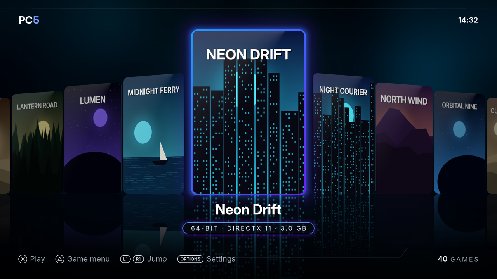
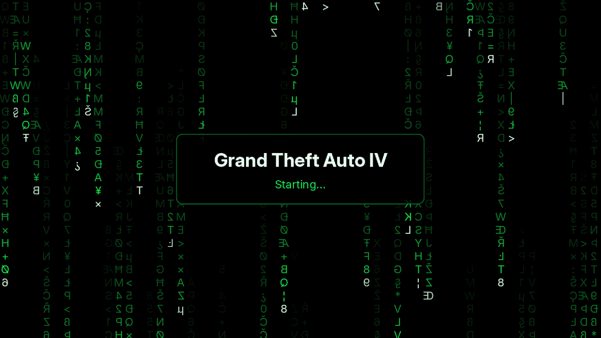
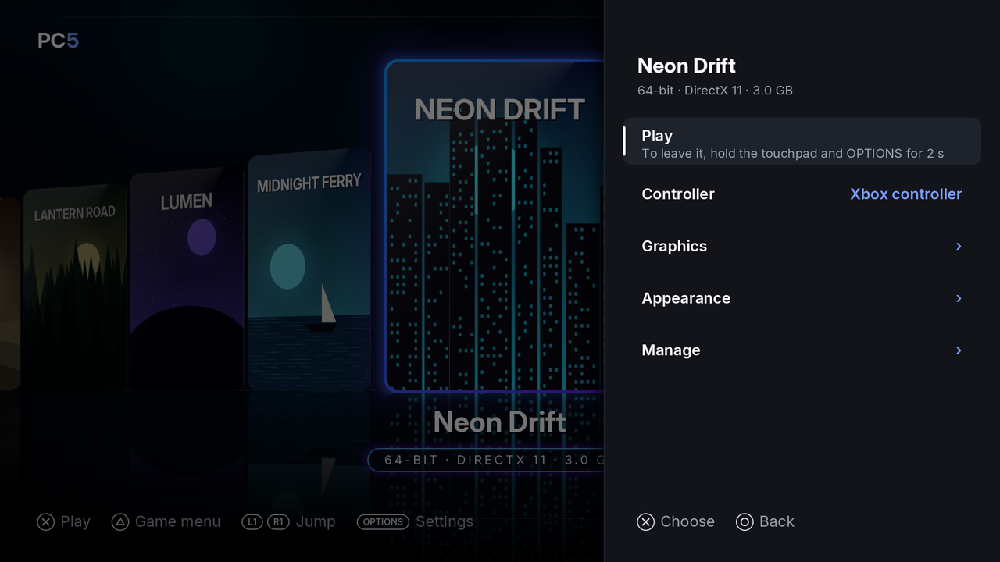
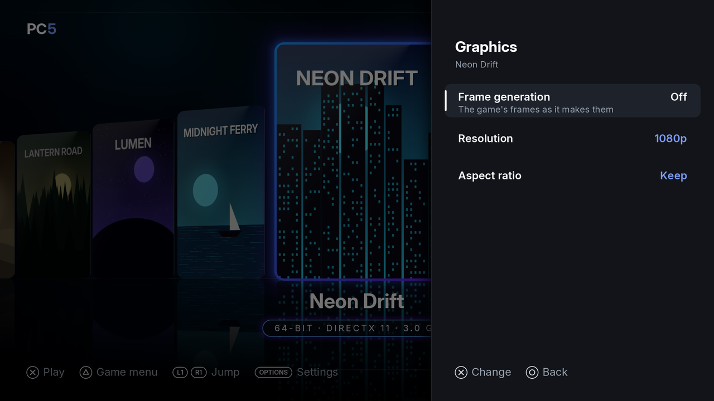
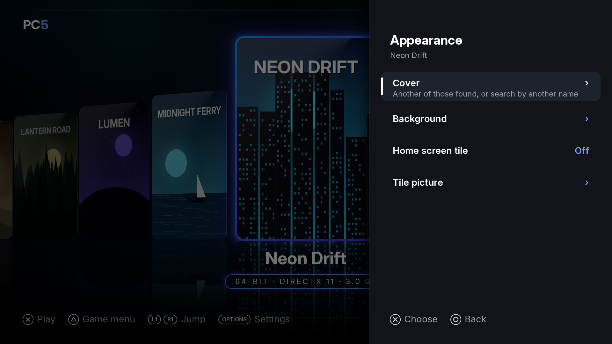
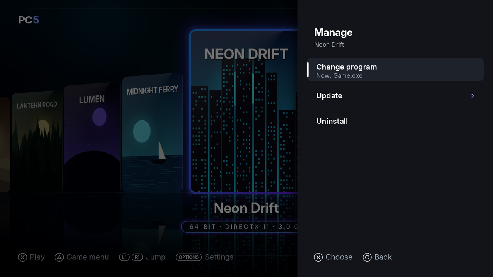
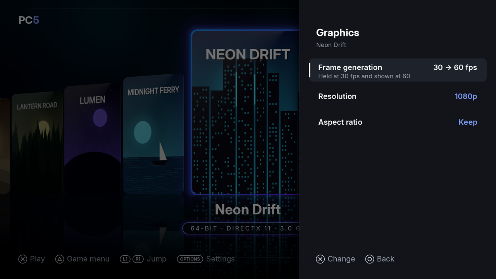

Your installed games are in PC5's library, a row of covers sorted by name, standing on a floor that mirrors them. From there you start a game, open its menu to set it up, and come back to PC5 when you leave it. This page covers the library, starting and leaving a game, the game menu and frame generation.

## The library

*The library. The chosen game stands in the middle, lit in its cover's colours; under it, its name and, in the pill, 32-bit or 64-bit, what it draws with, and its size. Behind it, its background, or a backdrop made from its cover (see [Backgrounds](Covers#backgrounds)).*

| Button | In the library |
| --- | --- |
| Left / right, or the left stick | Move between games |
| L1 / R1 | Jump to the first game of the previous or next letter |
| ✕ | Play the chosen game |
| △ | The chosen game's menu |
| Options | Settings |

If the console is set to confirm with **○**, PC5 follows it: **○** plays and chooses, and **✕** goes back.

When PC5 opens, the game you played last is chosen. The library holds up to 128 games. The clock at the top right is the console's.

### Using a USB keyboard in PC5

A USB keyboard works in PC5's own screens too:

| Key | Does what |
| --- | --- |
| Arrow keys | Move |
| Enter or Space | ✕ (choose) |
| Escape or Backspace | ○ (back) |
| F1, Tab or the menu key | Options |
| F2 or Delete | □ |
| F3 | △ |
| Page Up / Page Down | L1 / R1 |

## Starting a game

1. Choose the game in the library.
2. Press **✕** (or choose **Play** in its menu).

PC5 shows a loading screen with the game's name until the game shows its first picture.

*The loading screen, shown until the game draws its first picture.*

Good to know:

- Each game's Windows language is the PS5's language, so a game that follows the Windows language follows the console.
- PC5's [settings](Settings) (overlay, vibration, light bar, triggers) and the game's own settings (controller, frame generation, [launch options](Launch-options)) are read each time the game starts. A change takes effect the next time you start it.

## Leaving a game

Hold the **touchpad** and **Options** together for **two seconds**.

1. The controller gives a short buzz: the hold was taken.
2. PC5 asks the game to close (as Alt+F4 does on a PC), so it can save.
3. If the game hasn't closed after five seconds, it is ended.
4. You are back in PC5. If you started the game from its [home screen tile](Home-screen-tiles), you are back on the home screen.

This works in every controller mode and can't be remapped. Don't use it to close a pop-up in the game: it always leaves the game. See [a game's Windows pop-ups](Controllers#a-games-windows-pop-ups) for those.

If the game crashed or closed before showing anything, PC5 tells you when it opens again, and keeps the log. See [Reporting a problem](Reporting-a-problem).

## The game menu

Choose a game in the library and press **△**. Its menu has what you change most, and three groups: **Graphics**, **Appearance** and **Manage**. The row chosen says what it does under its name.

*The game menu. Its settings are kept for this game only.*

| Row | What it does |
| --- | --- |
| Play | Starts the game. |
| Controller | What the game sees: **Xbox controller** (the default), **DualSense**, or **Keyboard & mouse**. Press **✕** or left / right to change it. See [Controllers](Controllers). |
| Button mapping | Only with Keyboard & mouse: what each button and stick sends. See [Controllers](Controllers#button-mapping). |
| Graphics › | Graphics API, frame generation, resolution, aspect ratio, memory and CPU sharing. See [Graphics](#graphics). |
| Appearance › | The game's cover, its background and its home screen tile. See [Appearance](#appearance). |
| Manage › | The program PC5 starts, updating the game and uninstalling it. See [Manage](#manage). |

**○** goes back from a group to the menu, and from the menu to the library. **△** closes the menu from anywhere in it.

### Graphics

*Graphics: what changes how the game is drawn.*

| Row | What it does |
| --- | --- |
| Graphics API | Only for games drawn with Direct3D or DirectDraw: what turns the game's graphics into Vulkan, which the console draws with. See [Graphics API](#graphics-api) below. |
| Frame generation | **Off** (the default) or **30 → 60 fps**. See [Frame generation](#frame-generation) below. |
| Resolution | Only for games drawn with Direct3D, Vulkan or OpenGL: **1080p** (the default), **1440p** or **4K**. See [Resolution](#resolution) below. |
| Aspect ratio | **Keep** (the default) or **Stretch**. See [Aspect ratio](#aspect-ratio) below. |
| Memory | Only for 32-bit games: **4 GB** (the default since 1.4.0) or **2 GB**. A 32-bit game gets 4 GB of address space, room for big textures and mods. Set 2 GB for a game that misbehaves with it. |
| CPU sharing | **Off** (the default) or **On**. The console runs each of a game's threads on a CPU of its own until it waits, where Windows lets them take turns, so a game that keeps more threads busy than its 13 CPUs can stop for seconds at a time and carry on after a while, or after the PS button. **On** gives the game's threads turns, as on a PC. It applies the next time the game starts. |

### Appearance

*Appearance: how the game looks in PC5 and on the home screen.*

| Row | What it does |
| --- | --- |
| Cover | Another of the covers found for the game, one found for a name you type, or the card made from its icon. See [Changing a cover or background](Covers#changing-a-cover-or-background). |
| Background | Another of the backgrounds found, one found for a name you type, or none. See [Changing a cover or background](Covers#changing-a-cover-or-background). |
| Home screen tile | **Off** or **On**: a tile on the PS5's home screen that starts this game. See [Home screen tiles](Home-screen-tiles). |

### Manage

*Manage: the game's program, a newer version, and uninstalling.*

| Row | What it does |
| --- | --- |
| Change program | The program PC5 starts for this game ("Now: …"). Choose another one if PC5 picked the wrong one. See [Choosing the right program](Installing-games#choosing-the-right-program). |
| Update | Only for games PC5 installed: copies a newer version from the USB drive over the game. Its saves, settings and options stay. See [Updating a game](Installing-games#updating-a-game). |
| Uninstall | Deletes the game, keeping its saves or not, after asking. See [Uninstalling a game](Installing-games#uninstalling-a-game). |

## Frame generation

Frame generation shows a game at 60 fps when it runs at 30. It is set for each game: **△ › Graphics › Frame generation**, **Off** by default.

*Frame generation on: the game is held at 30 fps and shown at 60.*

How it works: the game is held at 30 fps, and before each of its frames PC5 shows one made between it and the one before, with [ps5-framegen](https://github.com/Swordpdf/ps5-framegen)'s interpolator (AMD FSR3's optical flow).

What to expect:

- It suits games that keep 30 fps or a little more. When a game falls below 30, its frames are shown as they come, without frames in between, until it keeps up again.
- Frames made in between can show smearing around fast movement and at the screen's edges.
- The game reacts a little later than without it.
- The overlay's FPS counts every frame shown, the made ones too, so it shows about 60.
- It works with games drawn with Direct3D 8 to 12, Vulkan or OpenGL. It doesn't apply to DirectDraw or plain Windows drawing, nor to 10-bit (HDR) output.
- A change takes effect the next time the game starts.

## Resolution

A game drawn with Direct3D, Vulkan or OpenGL can be drawn at **1080p** (the default), **1440p** or **4K**: **△ › Graphics › Resolution**, kept for that game.

- The console shows 1080p and 4K pictures as they are, and a 1440p one scaled up to 4K.
- A higher resolution is slower: 1440p is nearly twice the work of 1080p, and 4K four times. A game that is already slow at 1080p gets slower.
- Games drawn with DirectDraw or plain Windows drawing are drawn at 1080p, so the row isn't shown for them.
- A change takes effect the next time the game starts.

## Graphics API

From 1.9.2, **△ › Graphics › Graphics API** chooses who turns a game's Direct3D or DirectDraw into Vulkan. **Auto** (the default) is what PC5 chooses, and suits most games; the others are for a game that doesn't run, or doesn't look right, that way:

| Choice | Direct3D 8 to 11 | Direct3D 12 | DirectDraw |
| --- | --- | --- | --- |
| **Auto** | DXVK | VKD3D-Proton | WineD3D with OpenGL |
| **WineD3D** | Wine's own Direct3D, with OpenGL | — | — |
| **WineD3D on Vulkan** | Wine's own Direct3D, drawing with Vulkan itself | — | Wine's own, drawing with Vulkan itself |
| **Wine's VKD3D** | — | Wine's own Direct3D 12 | — |

From 1.9.3 it opens a window with the game's choices and what each does, the one in use marked **In use**: choose one with ✕, or leave with ○. It applies the next time the game starts, and stays with the game. Wine's own Direct3D is usually slower than DXVK and VKD3D-Proton, and WineD3D on Vulkan is the newest of them; if a game only runs with one of them, say so in its [issue](Reporting-a-problem) or [compatibility report](Game-compatibility).

## Aspect ratio

A game whose picture has another shape than the screen's, such as a 4:3 game, is shown in its own shape with black bars beside it. **△ › Graphics › Aspect ratio › Stretch** fills the screen with it instead, kept for that game.

- A stretched picture is wider than it was drawn: round things look oval.
- Set the game's own resolution in its options to the 4:3 one it was made for, such as 1024x768: a game that draws its own bars inside a 16:9 picture keeps them, as PC5 can't tell them from the picture.
- A change takes effect the next time the game starts.

## .NET games

.NET Framework games and tools (XNA through FNA, MonoGame, WinForms) run with [Wine Mono](https://gitlab.winehq.org/mono/wine-mono), the open-source stand-in for Microsoft's .NET Framework that Wine itself uses.

- The first time a .NET game starts, PC5 shows **Setting up .NET for your games, once** while it copies the runtime (some 230 MB) to `/data/prospero-win/pc5/`. Every .NET game uses that one copy, so the next ones start straight away.
- A .NET game installed with an older PC5 gets what it needs the next time it starts.
- It isn't Microsoft's .NET: programs that mix .NET and C++ (C++/CLI) don't run, and some WPF doesn't.

## The overlay

PC5 can show an overlay over every game: FPS, frame time, CPU usage, CPU and SoC temperatures, and memory. Turn it on in **Settings › Overlay**. See [Settings](Settings#overlay).

## When a game doesn't start

If PC5 can't start a game, it says why: for example "*Game* can't start" with the reason. See [Troubleshooting](Troubleshooting) for PC5's messages and what to do about them.

Games installed in `/data/prospero-win` some other way (not with PC5) show up in the library too, and get a cover the first time PC5 opens. Their program is set in their prospero-win profile, so **Change program** doesn't apply to them.
