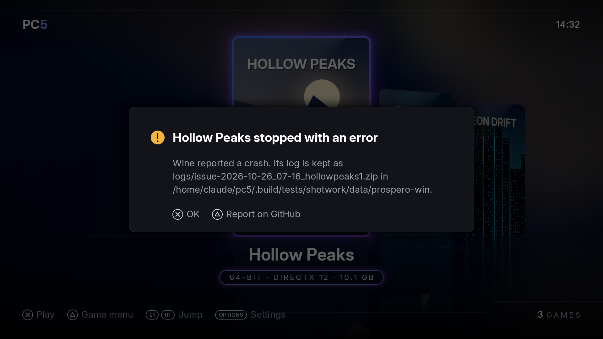
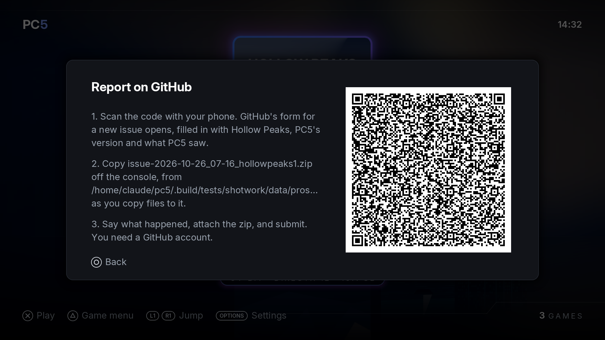

If a game won't start, crashes, or PC5 itself does something wrong, please report it as an issue on GitHub, with the game's log attached. The log is what lets the cause be found. This page explains where to report, what to include, and where to find the log.

## Where to report

Report problems as **GitHub issues**: <https://github.com/bornaradusin/PC5/issues>

Please don't report problems in ProsperoStore comments. Comments can't hold a log file, and they can't be followed up the way an issue can.

## Before you report

1. **Update to the newest PC5** and try again. A log from an older version often shows a problem that is already fixed. See [Updating PC5](Installing-and-updating#updating-pc5).
2. **Check the program.** If the game closes at once, PC5 may have started the wrong `.exe`. See [Choosing the right program](Installing-games#choosing-the-right-program).
3. **Try another controller mode** if the game doesn't react to the controller. See [Controllers](Controllers).
4. **Look at [Troubleshooting](Troubleshooting)** and at the [existing issues](https://github.com/bornaradusin/PC5/issues?q=is%3Aissue): someone may have reported it already.

## What to include

1. **The PC5 version**, from **Settings › About PC5** (press **Options** in the library). For example `1.8.3`.
2. **The game**: its name, and the program PC5 starts for it (shown in the game's menu under **Manage › Change program**).
3. **What happened**: what you did, where it stopped, what was on screen, and whether it happens every time.
4. **How the game is set up**, if you changed anything: its controller mode, frame generation, and any [launch options](Launch-options).
5. **The log** of that session: the zip PC5 kept, attached as a file (see below).

## Finding the log

PC5 keeps logs in:

```text
/data/prospero-win/logs/
```

While a game runs, its log is written as `session-N.log`, and put on the console's storage every two seconds, so it survives even if the console freezes and has to be switched off. When PC5 next opens, it files the sessions that have ended, each as **one zip**:

- A session that **went wrong** is kept as `issue-<when>_<game>.zip`: the game crashed, closed within a minute without showing anything, or didn't close when asked and had to be ended.
- Each game's **newest session** is kept as `log-<when>_<game>.zip` even when nothing went wrong, so a problem without a crash (no sound, a wrong picture, a freeze) still has its log. Playing that game again replaces it.
- PC5's own sessions that went well are deleted, unless **Settings › System › Keep all logs** is **On** (then every session is kept).
- Nothing in `logs/` is kept longer than **seven days**.

`<when>` is the date and time the session began, on the console's clock (`2026-10-25_14-17`), and `<game>` is the game's id (`neon-drift`, for example; `launcher` for PC5's own sessions).

The zip holds everything a report needs:

| In the zip | What it is |
| --- | --- |
| `issue-…_<game>.log` (with `-earlier` and `-start` for a long session) | PC5's log of the session |
| `about.txt` | what PC5 saw, the program, the console's firmware, and the list of the game's files below |
| `game/…` | the files the game itself wrote while it ran: its own logs, crash reports and crash dumps (Unity's `Player.log`, a `log.txt` in My Games, `crash.xml`, `.dmp` files), from its folders under `C:\users` and its own folder |

Attach the zip as it is. You don't need to look for the game's own logs.

When a session went wrong, PC5 tells you the next time it opens, and names the zip it kept:


*After a crash, PC5 names the log it kept. △ reports it on GitHub.*

| PC5 says | What happened |
| --- | --- |
| *Game* stopped with an error | Wine reported a crash in the game, or the game's own crash handler caught one. |
| *Game* closed before showing anything | The game ended within a minute of starting without showing a picture, or Wine couldn't start it. Check the program first. |
| *Game* had to be closed | The game didn't close when asked, so PC5 ended it. |
| PC5 ended unexpectedly last time | PC5 itself stopped while it ran. Its log is `issue-<when>_launcher.zip`. |

### Report on GitHub from PC5

In that message, press **△**. PC5 shows a QR code: scan it with your phone, and GitHub's form for a new issue opens, already filled in with the game, its program, PC5's version, the console's firmware and what PC5 saw. Say what happened, attach the zip it names, and submit.


*The QR code opens the issue form; the zip to attach is named beside it.*

The QR code only opens the form: nothing is sent until you submit it, and the log goes only if you attach it.

### When there is no message

- **The game froze, or you had to restart the console.** Attach that game's newest `log-…` (or `issue-…`) zip: it holds the session up to a few seconds before it stopped. Its `about.txt` says the log has no end line. Don't play the game again before copying it, as that replaces it.
- **Something went wrong but nothing crashed** (no music, a wrong picture): attach the game's newest `log-…` zip, and say what you saw and when.
- **You started the game from its [home screen tile](Home-screen-tiles).** Leaving the game goes back to the home screen, so PC5 hasn't opened since. Open PC5 once: it files the log then.
- **An install or uninstall went wrong.** PC5 keeps that session's log as `issue-<when>_launcher.zip`, once PC5 has been closed and opened again. It doesn't show a message for it.

### Copying the log off the console

Copy the zip from `/data/prospero-win/logs/` with the tool you use to move files to and from the console (an FTP server payload, for example). Drag it into the issue's text box.

PC5 1.6.0 and older kept logs as `.log` files (with `-earlier` and `-start` parts) rather than zips. Attach all of them if that is what you have.

## What a crash log contains

From PC5 1.3.0, when a game crashes its log has a crash report: lines starting with `wine: crash report:`. They give the module and offset the crash happened at (such as `game.exe+0x1a2b3c`), the registers, and the code addresses on the stack. From 1.6.1 this is there too when the game's own crash handler catches the crash (the line before says `handed to the program's own crash handler`). The first lines of each log name the console's firmware and PC5's version.

## A more detailed log, for one game

Sometimes the log doesn't show why a game stops, and the issue's answer asks for a more detailed one, or for the game to be started another way. [Logs and debugging](Logs-and-debugging) says how, with the lines most often asked for.

## Opening the issue

1. Press **△** on PC5's message and scan the code (see [Report on GitHub from PC5](#report-on-github-from-pc5)), or go to <https://github.com/bornaradusin/PC5/issues> and choose **New issue**. You need a GitHub account.
2. Give it a title that says what goes wrong, for example "Game closes before showing anything after its intro video".
3. Write the details from [What to include](#what-to-include).
4. Drag the zip into the text box, wait for it to upload, and submit.

Thank you: every report with a log helps more games run.
