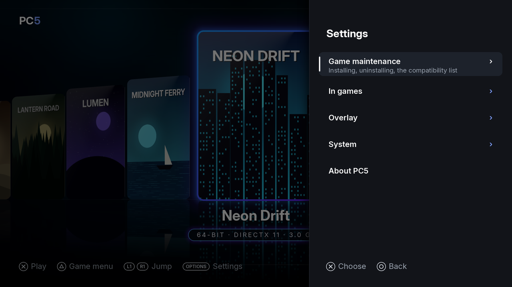
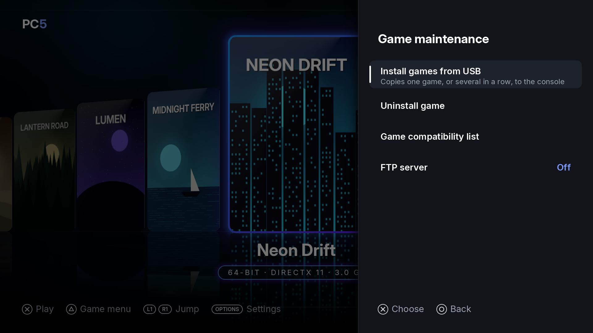
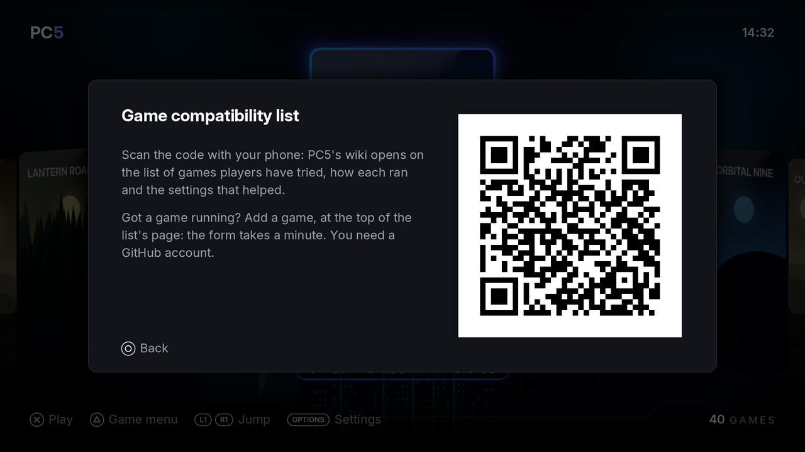
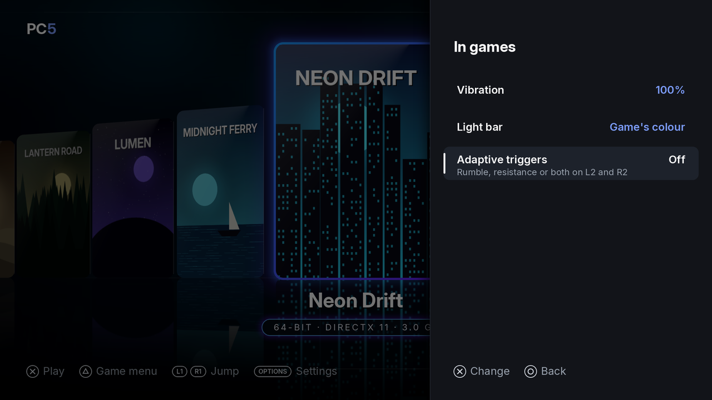
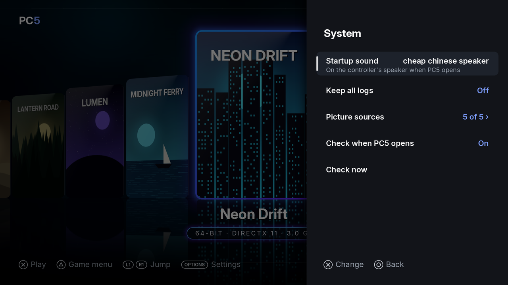
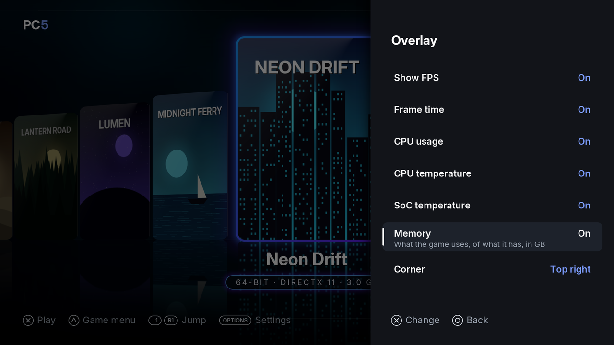
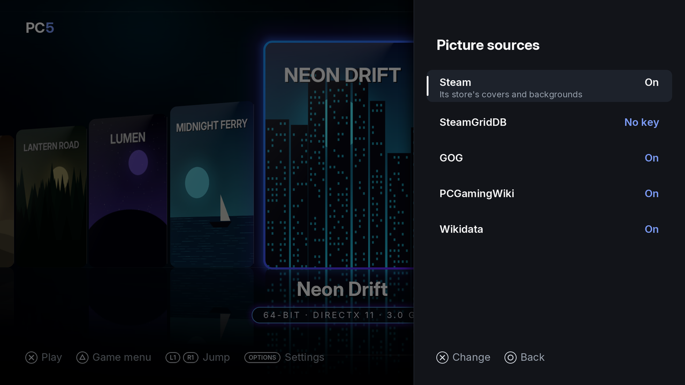
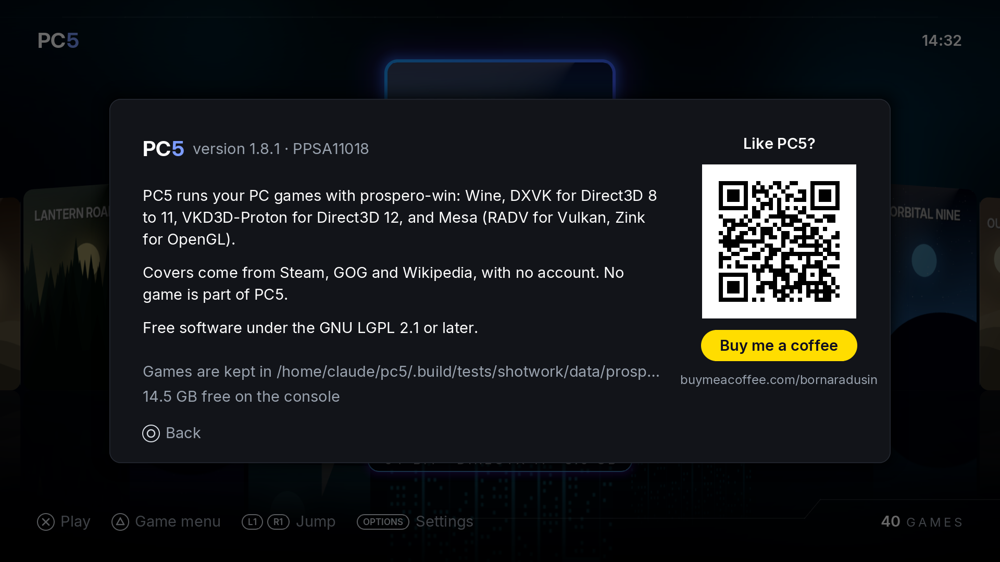

PC5's Settings hold installing and uninstalling games and the game compatibility list, the settings that apply in every game (the controller's rumble, light bar and triggers, and the overlay), PC5's own system settings (the startup sound, the logs, where covers and backgrounds come from, and updates) and the About screen. Settings that belong to one game (its controller, graphics, cover, background, home screen tile and program) are in that game's menu instead: see [Playing games](Playing-games#the-game-menu). The row chosen says what it does under its name.

## Opening Settings

Press **Options** in the library. Settings opens on the right.

*Settings: its first page. A › means the row opens a page of its own.*

| Button | In Settings |
| --- | --- |
| Up / down | Move between rows |
| ✕ | Open the row, or change its value |
| Left / right | Change the value of a row that has one |
| ○ | Back (from a page, to the first page; from the first page, to the library) |
| Options | Close Settings |

Changes are saved at once, in `/data/prospero-win/pc5/settings.txt`. Settings for games apply from the next time a game starts.

## The first page

| Row | What it does |
| --- | --- |
| Game maintenance › | Installing and uninstalling games, and the game compatibility list. See [Game maintenance](#game-maintenance). |
| In games › | Vibration, light bar and adaptive triggers. See [In games](#in-games). |
| Overlay › | The overlay shown over every game. See [Overlay](#overlay). |
| System › | The startup sound, the logs, the picture sources and updates. When a newer PC5 is out, the row says so. See [System](#system). |
| About PC5 | The version, where games are kept, the free space on the console, and a QR code for Buy Me a Coffee. |

## Game maintenance

*Settings › Game maintenance.*

| Row | What it does |
| --- | --- |
| Install games from USB | Copies one game, or several in a row, from a USB drive to the console. See [Installing games](Installing-games). |
| Uninstall game | Lists your games to uninstall one, keeping its saves or not, then the saves kept from games uninstalled before, to delete them. See [Uninstalling a game](Installing-games#uninstalling-a-game). |
| Game compatibility list | Shows a QR code: scan it with your phone to open the [game compatibility list](Game-compatibility), the games players have tried, how each ran and the settings that helped. **Add a game** at the top of that page reports one of yours. |

*Game maintenance › Game compatibility list.*

## In games

*Settings › In games, with both trigger effects on. Trigger rumble and Trigger resistance only show while their effect is on.*

| Row | Values | What it does |
| --- | --- | --- |
| Vibration | Off, 25, 50, 75, **100 %** | How strongly the controller rumbles with the game. Off: no rumble. |
| Light bar | **Game's colour**, Follows the screen, Console's colour | Game's colour: the main colour of the game's cover. Follows the screen: the colour of what is on screen, changing with it. Console's colour: PC5 leaves the light bar as the console has it. |
| Adaptive triggers | **Off**, Rumble, Resistance, Rumble + resistance | Rumble: L2 and R2 vibrate with the game's rumble. Resistance: they push back as you press them. Rumble + resistance: they push back, and vibrate instead while the game rumbles (a trigger runs one effect at a time). |
| Trigger rumble | 25, 50, 75, **100 %** | How strongly L2 and R2 vibrate. Shows with Rumble or Rumble + resistance. |
| Trigger resistance | 25, **50**, 75, 100 % | How firmly L2 and R2 push back. Shows with Resistance or Rumble + resistance. |

Defaults are in **bold**.

These follow the settings in every game, whatever its [controller mode](Controllers). With the **DualSense** mode, a game that sets its own light bar or trigger effects gets them instead, from the moment it sets them. When a game ends, PC5 gives the controller back as the console had it.

## System

*Settings › System.*

| Row | Values | What it does |
| --- | --- | --- |
| Startup sound | Off, **cheap chinese speaker**, and the other sounds by name | The sound on the controller's speaker when you open PC5 from the home screen (not when you come back to it from a game). Choosing a sound plays it. See [Startup sound](#startup-sound). |
| Startup sound volume | 10 to **100 %**, in steps of 10 | How loud the startup sound plays. Changing it plays the sound at the new volume. Shows while a startup sound is chosen. |
| Keep all logs | **Off**, On | Off: the logs of sessions that went wrong are kept, and each game's newest session. On: every session's log is kept, PC5's own too. Either way, each is one zip, kept for 7 days. See [Reporting a problem](Reporting-a-problem). |
| Picture sources › | the number turned on | Where PC5 looks for covers and backgrounds. See [Picture sources](#picture-sources). |
| Check when PC5 opens | **On**, Off | On: PC5 asks GitHub for a newer release each time you open it, and offers it when there is one. Off: only when you ask. |
| Check now | | Asks GitHub straight away. The answer shows under the row. |
| Update now | | Shows while a newer release is out: downloads it from GitHub, puts it in place of this PC5 and restarts PC5. |

When a newer PC5 is out, PC5 asks when it opens whether to update now or later. PC5 never updates without asking. See [Updating PC5](Installing-and-updating#updating-pc5).

## Startup sound

**Settings › System › Startup sound** chooses the sound PC5 plays on the controller's speaker when you open it, or **Off**. Choosing a sound with **✕** or left and right plays it, so you can hear it. **Startup sound volume**, under it, sets how loud the sound plays, from 10 to 100 %; changing it plays the sound at the new volume. PC5 sets this volume itself: the console's own Controller Speaker Volume doesn't change it.

PC5 comes with **Beeper - Push**, **Cha-Ching**, **cheap chinese speaker** (the default), **fahh**, **funny message tone**, **rizz** and **System Activated**.

To add your own:

1. On the console, make a folder `/data/prospero-win/sounds/` if there isn't one.
2. Put a `.wav` file in it. Its name, without `.wav`, is how it shows in the list: `Chime.wav` shows as **Chime**. A sound of yours with the name of one of PC5's takes its place.
3. Open Settings again: the sound is in the list.

The file can be mono or stereo, 8, 16 or 24-bit or 32-bit float, at any sample rate; PC5 plays the first 30 seconds. The controller's speaker is small, so a short, loud sound works best. If the sound chosen is deleted, PC5 plays cheap chinese speaker.

## Overlay

The overlay is a small box over every game, updated every second. Each line can be turned on or off.

*Settings › Overlay, with every line turned on.*

| Row | Shows |
| --- | --- |
| Show FPS | Frames shown each second. On its own, it is a large counter. |
| Frame time | How long a frame takes, on average, in milliseconds |
| CPU usage | How much of the console's CPU the game uses |
| CPU temperature | The CPU's temperature, in degrees Celsius |
| SoC temperature | The console chip's temperature, in degrees Celsius |
| Memory | The memory the game uses, of what it has, in GB |
| Corner | Where the overlay sits: Top left, **Top right**, Bottom left or Bottom right |
| Size | **Normal**: every line at once, in small text. **Large** (from 1.9.2): twice the size, readable from the sofa, two lines at a time, the next two every 3 seconds when more are on. The memory then shows the GB in use. **Extra large** (from 1.9.5): every line at once, as Normal, shown at twice the size by the console (its overlay image magnified by the display), at no cost to the game; nothing takes turns. If the console refuses that, the overlay stays at Normal's size and the game's log says `PC5 overlay magnified=1 rc=…`. |

All lines are **Off** by default. A line the console can't read is left out. With [frame generation](Playing-games#frame-generation) on, the FPS counts every frame shown, the made ones too.

## Picture sources

**Settings › System › Picture sources** turns each place PC5 looks for covers and backgrounds on or off. All are **On** by default, and none needs an account or a key.

*Settings › System › Picture sources.*

| Source | What PC5 takes from it |
| --- | --- |
| Steam | Its store's cover and library background for the game |
| SteamGridDB | Covers and backgrounds its members made. Only with your own key: see [Covers › SteamGridDB](Covers#steamgriddb). Without one the row says **No key** |
| GOG | Its catalogue's cover and background |
| PCGamingWiki | The cover on the game's page, and the background of the Steam game the page names |
| Wikidata | Steam's cover and background for a game Steam's own search doesn't find by that name |

A source turned off isn't asked when PC5 installs a game, looks for its background, or when you choose a cover or background by hand. Pictures already kept stay. See [Covers](Covers).

## About PC5

Shows the PC5 version and title ID (`PPSA11018`), what PC5 runs games with, where games are kept (`/data/prospero-win`) and the free space on the console. If you like PC5, scan the QR code with your phone: it opens PC5's [Buy Me a Coffee](https://www.buymeacoffee.com/bornaradusin) page. Press **○** to close it.

*About PC5. Give this version when you report a problem.*
